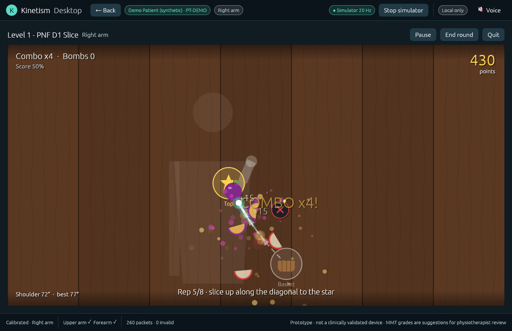
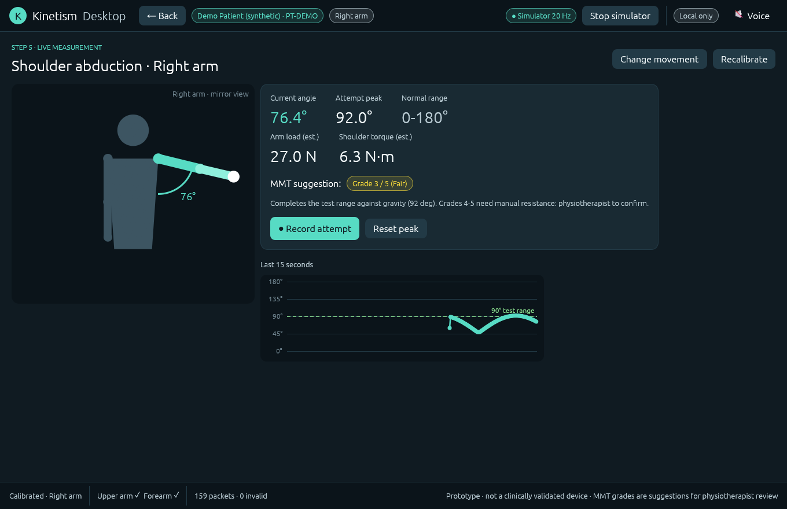
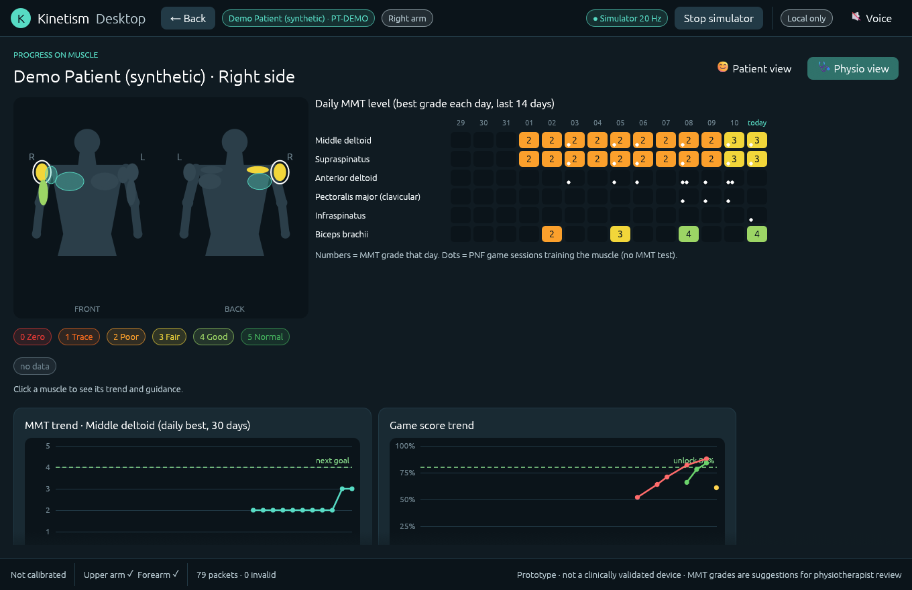
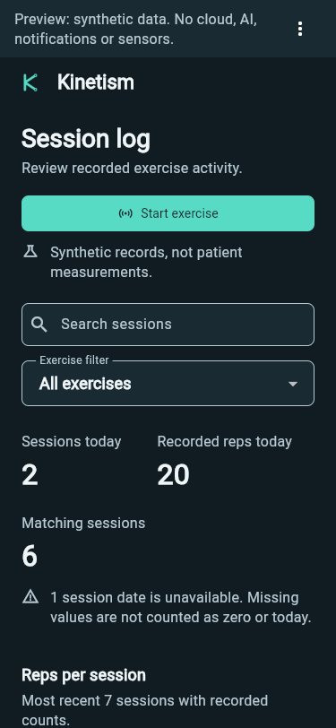
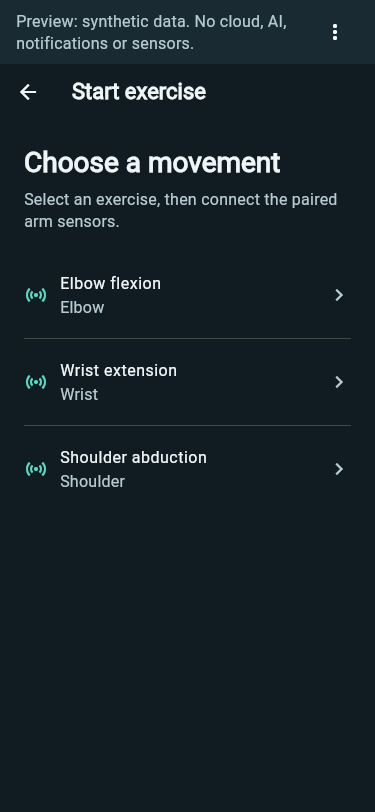
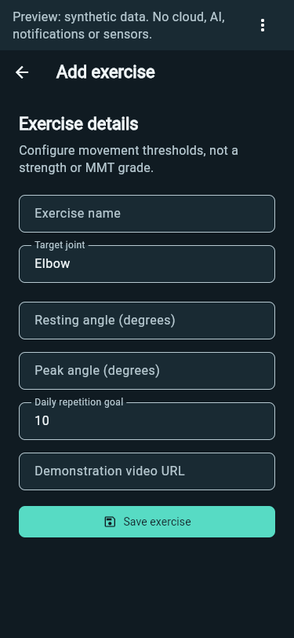
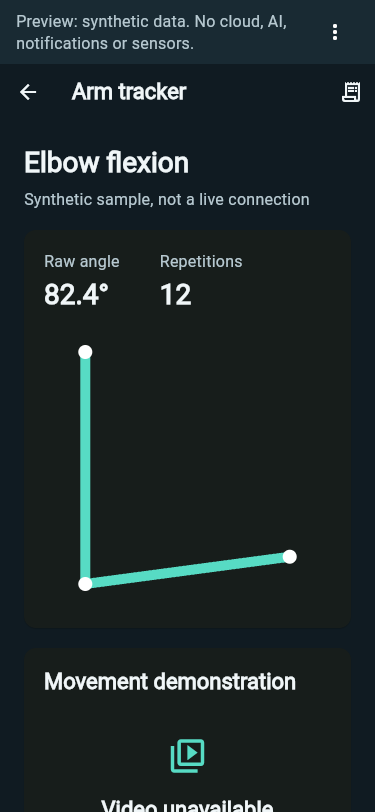
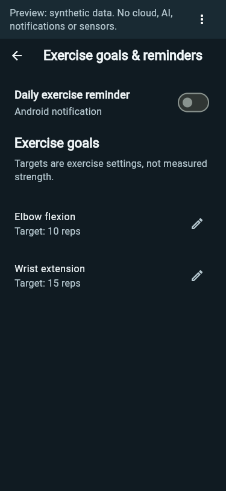
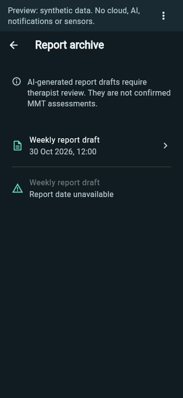

# Kinetism

ESP32-C3/BNO080 motion telemetry, a local PC dashboard, and the refined
Flutter rehabilitation prototype. This is development software, not a
clinically validated medical device.

## Download the Android prototype

[Download Kinetism for Android](https://github.com/tansiang9389-gif/Kinetism-motion-telemetry/releases/download/prototype-refinement-20261031/kinetism-prototype-1.0.0-debug.apk)
or open the [development release](https://github.com/tansiang9389-gif/Kinetism-motion-telemetry/releases/tag/prototype-refinement-20261031).

Android 7.0 or newer is required. The APK is debug-signed and intended for a
dedicated test phone, not clinical use. AI coaching and new AI report generation
are unconfigured in the public build; no private provider key is bundled.
Firebase client configuration is retained, but backend rules, persistence,
physical sensors and notifications have not been validated.

Patient selection, illustrated arm measurements, calibrated force, MMT position
capture and authenticated phone/PC patient-record sync are not implemented.
See the [app documentation](apps/medical_device_app/README.md) for the exact
feature boundaries, installation details and verified APK checksum.

## App features

The Flutter app implements the 9-step physiotherapist measurement and record-logging workflow around the paired-arm sensors (`Physio_A`):

| Feature | What you can do |
| --- | --- |
| **1. Patient selection & creation** | Choose from the searchable list of past patients, register a **New patient** (`Patient name` and optional `Patient ID`), or open the **Overall record log** directly. |
| **2. Measure or Record log sections** | Select **1 of 2 sections** for the chosen patient: **Measure** (to start a new body-part assessment) or **Record log** (to review saved measurements). |
| **3. Body part selection (Arm first)** | Select which body part you are measuring (**Arm** is active first, using the upper-arm and forearm sensors). |
| **4. Illustrated arm anthropometrics** | Key in **Circumference of bicep (cm)**, **Circumference of forearm (cm)**, and **Length of arm (cm)** guided by an on-screen anatomical diagram showing where to measure (`1 Bicep`, `2 Forearm`, `3 Length of arm`) for accurate force calculation. |
| **5. Start measuring** | Press **Start measuring** once the patient's arm dimensions are recorded and the patient is wearing the sensors. |
| **6. Position capture (Angle, Force, AI MMT grading)** | Ask the patient to perform the target movement and press **Record** when they reach the desired position. Records **Angle (°)**, biomechanical **Force (N)**, and **AI MMT grading (Grades 0–5)**. |
| **7. Record again** | Press **Record again** to capture additional attempts in the same session without losing earlier recorded attempts. |
| **8 & 9. Patient & Overall record logs** | Every recorded attempt is saved into the **Record log**. Physiotherapists can refer to the patient's **Record log** or the **Overall record log** across all patients at the end of the day. |

### 9-step physiotherapist workflow

1. **Select patient**: Choose a past patient, tap **New patient**, or open the **Overall record log**.
2. **Choose section**: Select **Measure** or **Record log**.
3. **Select body part**: Choose **Arm** to configure the upper-arm and forearm measurement.
4. **Enter arm measurements**: Follow the illustrated diagram to key in **Circumference of bicep (cm)**, **Circumference of forearm (cm)**, and **Length of arm (cm)**.
5. **Start measuring**: Tap **Start measuring** while the patient wears the sensors.
6. **Record target position**: Ask the patient to perform the movement and tap **Record** at the desired position to capture **Angle (°)**, **Force (N)**, and **AI MMT grading**.
7. **Record again**: Tap **Record again** if you want to record additional movement attempts.
8. **Saved in record log**: Each recorded attempt is automatically stored in the record log with its attempt number, arm dimensions, angle, force, and AI MMT grade.
9. **End-of-day reference**: Open the patient's **Record log** or the **Overall record log** at any time for clinical reference.

### Explore the screens without hardware

The [synthetic browser preview](apps/medical_device_app/README.md#local-synthetic-preview)
lets you walk through all 9 steps in the browser without Firebase, physical BLE sensors, or external services.

## Kinetism Desktop (Rust): shoulder abduction, PNF game, muscle progress

[apps/kinetism_desktop](apps/kinetism_desktop/README.md) is a Windows desktop
app, written in Rust with egui, for the same sensors. It connects directly from
the PC to the `Physio_A` pair over Bluetooth LE, or to a single Wi-Fi sensor
running the root PlatformIO firmware (`KIN1` UDP). It shares patients and
records with the phone app through Firestore.

* **Shoulder abduction**: two-pose calibration, live elevation angle with
  plane and elbow checks, estimated arm load and torque, an automatic MMT
  suggestion (grades 0-3) and physiotherapist confirmation of grades 4-5.
* **Fruit PNF game**: Fruit-Ninja-style levels driven by the patient's hand.
  Level 0 *Draw the Apple* (trace an apple outline), Level 1 *PNF D1*, Level 2
  *PNF D2*. Includes combos, bombs off the diagonal, stars, a daily streak,
  voice encouragement and an 80% score to unlock the next level.
* **Progress on muscle**: body map coloured by MMT grade, daily MMT level grid,
  MMT and game trends, and draft next-goal guidance per grade. There are
  separate patient and physiotherapist views.

```powershell
cd apps\kinetism_desktop
cargo run --release
```

A built-in simulator (mouse-driven virtual arm) allows demos without hardware.

| Level 1 - PNF D1 | Shoulder abduction | Progress on muscle |
| --- | --- | --- |
| [](docs/desktop/game-d1.png) | [](docs/desktop/measure.png) | [](docs/desktop/progress.png) |

Screenshots use synthetic demo data (`KINETISM_DEMO`), never real patients.

## App screenshots

Select any screenshot to view it at full size:

| 1. Select patient | 2. Measure or Record log | 4. Arm dimensions & diagram |
| --- | --- | --- |
| [](docs/refinement/screenshots/home-mobile-after.png) | [](docs/refinement/screenshots/exercises-mobile-after.png) | [](docs/refinement/screenshots/add-mobile-after.png) |

| 5–6. Live arm measurement | 6–7. Recorded position & Record again | 8–9. Overall record log |
| --- | --- | --- |
| [](docs/refinement/screenshots/tracker-mobile-after.png) | [](docs/refinement/screenshots/goals-mobile-after.png) | [](docs/refinement/screenshots/reports-mobile-after.png) |

## Project layout

| Folder | Purpose |
| --- | --- |
| [src](src) and [include](include) | Wi-Fi/UDP ESP32-C3 firmware and a non-secret configuration template |
| [pc](pc) | Local Python telemetry receiver and both browser dashboards |
| [tests](tests) | PC protocol regressions and saved paired-sensor Arduino reference sketches |
| [apps/medical_device_app](apps/medical_device_app) | Refined Flutter source, native projects, tests and editable branding |
| [apps/kinetism_desktop](apps/kinetism_desktop) | Rust desktop app: Bluetooth and Wi-Fi sensor input, shoulder abduction, Fruit PNF game, muscle progress |
| [firmware/physio-slave](firmware/physio-slave) | Buildable PlatformIO port of the ESP-NOW forearm slave sketch |
| [docs/refinement](docs/refinement/design-audit-kinetism.md) | Refinement review, synthetic browser evidence and screenshots |

[CHANGELOG.md](CHANGELOG.md) lists what changed in each release, and
[TODOS.md](TODOS.md) tracks open hardware and firmware work.

The original upload ZIP is retained as a sanitised **source-only** archive.
Configured Wi-Fi credentials and compiled/cache files have been removed from
that public copy. Original local files and Git history were not rewritten.
Rotate any real Wi-Fi credentials previously present in the archive and revoke
the former embedded AI API key; removing a current file does not erase history.

### Sensor integration boundaries

The [saved BLE master sketch](tests/master_1_1_1_1.ino) advertises `Physio_A`
and sends the eight quaternion CSV fields expected by the Flutter app.
The [saved ESP-NOW slave sketch](tests/C3_MS4_Slave__1___1_1.ino) is its reference
companion. These sketches were retained as supplied, not built or flashed during
this refinement; the slave reference lacks its BNO080 library header and needs
Arduino/library setup before it can be treated as a buildable firmware project.
[firmware/physio-slave](firmware/physio-slave/README.md) is a buildable
PlatformIO port of that slave, with the same protocol.

The root PlatformIO project instead builds the **Wi-Fi/UDP** firmware used by
the PC dashboard. Its binary UDP packets are not the Flutter BLE payload.
Do not flash that firmware expecting the phone's BLE tracker to read it.
Kinetism Desktop reads both: the BLE payload and the `KIN1` UDP packets.
The synthetic browser preview is not a synchronised clinical PC portal.

## What the Wi-Fi prototype measures

- Fused relative orientation from the BNO080 game rotation vector
- Gravity-free linear acceleration on X/Y/Z
- Angular velocity
- Moving/stationary state
- Current and previous swing peak acceleration in `g`
- Right elbow flexion/extension angle, maximum flexion, and session range of
  motion when one IMU is mounted on the right forearm
- Estimated forearm/hand inertial force in newtons using a patient-specific
  moving mass

The swing metric is acceleration intensity, not force. This project does not
double-integrate acceleration into position because MEMS drift makes that
result unreliable.

## Hardware configuration

| Signal | ESP32-C3 pin |
| --- | --- |
| BNO080 SDA | GPIO 6 |
| BNO080 SCL | GPIO 7 |
| Switch | GPIO 3 |
| LED | GPIO 20 |
| Battery ADC | GPIO 4 |

The BNO080 address is `0x4B`.

## Configure the Wi-Fi firmware

1. Copy `include/secrets.example.h` to `include/secrets.h`.
2. Set the 2.4 GHz Wi-Fi SSID and password.
3. Keep `UDP_HOST` set to the PC's current IPv4 address
   (`192.168.43.253`) or update it after checking `ipconfig`.
4. Keep UDP port `4210` consistent between firmware and receiver.

`include/secrets.h` is ignored and must not be committed.

If Windows prompts, allow Python on private networks. Otherwise create inbound
rules for UDP port `4210` and TCP port `8000`.

## Build and flash firmware

```powershell
pio run
pio run --target upload --upload-port COM3
pio device monitor --port COM3 --baud 115200
```

Confirm COM3 is still the ESP32-C3 before uploading. Uploading replaces the
currently installed ESP-NOW firmware. The saved reference sketches remain in
[tests](tests), but they are not selected by this PlatformIO build.

## Run the dashboard

From the project root:

```powershell
python -m pip install -r pc\requirements.txt
python -m pc.app.main
```

Two dashboard variants are stored in separate folders and use the same
telemetry receiver:

- Current right-elbow dashboard: <http://127.0.0.1:8000/elbow/>
- Initial motion prototype: <http://127.0.0.1:8000/initial-prototype/>

The root URL redirects to the elbow dashboard. Keep the sensor stationary for
roughly 1.5 seconds after telemetry starts so the movement detector can
measure its noise floor.

For the one-IMU right-elbow view:

1. Secure the IMU to the right forearm with its +X axis pointing toward the
   wrist.
2. Keep the right upper arm fixed throughout the measurement.
3. Fully extend the elbow, then press **Set full extension (0°)**.
4. Flex and extend the elbow. The dashboard shows live angle, maximum flexion,
   session range of motion, and a 10-second angle trace.
5. Enter the patient's estimated forearm-plus-hand mass in kilograms. The
   displayed inertial force uses `force = mass × gravity-free acceleration`.
6. Set the force refresh threshold. At the default `1.0 N`, the displayed peak
   increases only when a new estimate exceeds the held peak by at least 1.0 N.
   The highest value remains visible after movement stops.
7. Press **Reset force peak** before a new trial. Setting full extension also
   resets the force peak.

One forearm IMU cannot separate elbow motion from shoulder or upper-arm
movement. Use a second upper-arm IMU later if the upper arm must move freely.
The newton value is not muscle force, elbow-joint force, torque, or force
against an external object; those require additional biomechanical inputs or a
load cell.

Optional ports:

```powershell
python -m pc.app.main --udp-port 4210 --web-port 8000
```

## Test

```powershell
python -m pip install -r pc\requirements-dev.txt
python -m pytest -q
pio run
```

## Protocol

Firmware sends one packed 64-byte little-endian UDP datagram per sample.

| Field | Type |
| --- | --- |
| Magic (`KIN1`) | `uint32` |
| Version, flags, packet size | `uint8`, `uint8`, `uint16` |
| Sequence, device timestamp ms | `uint32`, `uint32` |
| Quaternion `(w,x,y,z)` | 4 x `float32` |
| Linear acceleration `(x,y,z)` m/s² | 3 x `float32` |
| Gyro `(x,y,z)` rad/s | 3 x `float32` |
| Battery, quaternion accuracy, reserved | `uint8`, `uint8`, `uint16` |
| Measured sample rate Hz | `float32` |

Sequence gaps are reported on the dashboard rather than concealed.
